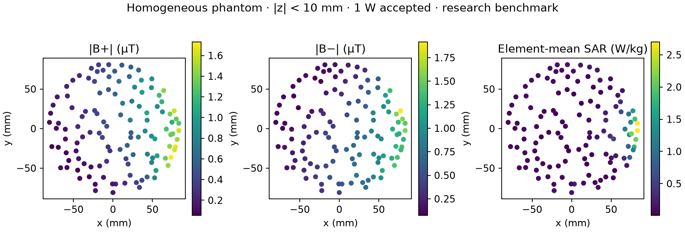
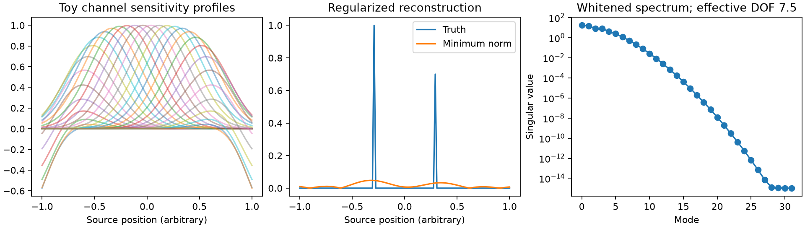

# MRI RF Stack

MRI RF field benchmarks built around **Hertzon/EMerge**, with analysis and
integration tools for the NeuroFedora scientific stack.

Version 0.1 provides a working eight-rung birdcage / homogeneous phantom model,
complex field import, accepted-power normalization, B1 components, local SAR,
ParaView output, JEMRIS coil-map export, and an **InI-inspired minimum-norm inverse**
for supplied multichannel forward operators.

The birdcage is a single-feed, nominal-capacitance research benchmark. It is not a
tuned commercial coil, a complete scanner, or a validated patient exposure model.
The 32-channel inverse example uses explicitly synthetic sensitivities; it is not
an electromagnetic simulation of a 32-channel head coil.



## Install the analysis tools

```sh
python -m venv .venv
source .venv/bin/activate
python -m pip install -e '.[test,plot]'
pytest -q
```

The analysis package supports Python 3.11+. Hertzon is optional and installed
separately: its current pinned release requires Python **below 3.14**. For the
solver workflow, create the environment with Python 3.12 and run:

```sh
python -m pip install -r requirements-solver.txt
```

Linux additionally needs the Gmsh/OpenGL runtime libraries (for example,
`libglu1-mesa libgl1 libegl1` on Ubuntu). No GUI is launched by the commands below.
The upstream dependency installation includes Qt and VTK and is a large download.

## Run the RF benchmark

```sh
mri-rf model outputs/birdcage
mri-rf solve outputs/birdcage/birdcage.hzn outputs/birdcage/solver
mri-rf analyze outputs/birdcage/solver outputs/birdcage/materials.json outputs/birdcage/analysis
python examples/plot_fields.py outputs/birdcage/analysis
```

Open `birdcage.hzn` in Hertzon to inspect/edit the geometry, or open
`analysis/fields.vtk` in ParaView. The solver output directory must be new/empty
to prevent accidental reuse of stale results. `--passes 1` gives a quick smoke
run; the default permits twelve adaptive passes.

The model uses 127.732435554 MHz (3 T protons), eight PEC strip rungs with tuning
capacitors, an open cylindrical PEC shield, a finite air region with an absorbing
boundary, and a synthetic phantom with εr=60, σ=0.5 S/m, ρ=1000 kg/m³. These are
declared benchmark parameters, **not sampled human tissue measurements**.
Capacitance defaults to 30 pF and the 50 Ω feed is not impedance matched.
All geometry/configuration values are saved alongside the project.

Use `--config custom.json` to override any `Birdcage` parameter in SI units,
or `--capacitance-pf` to explore tuning. The disabled `Resonance` frequency sweep
can be enabled in Hertzon; it holds phantom properties constant over frequency.
Mesh size, polynomial order, air-boundary distance, and capacitor/feed dimensions
all need convergence studies before quantitative coil design.

The importer accepts Hertzon 0.1.25's straight tet4/tet10 field layout and its
real-reference lumped ports. It preserves tetrahedron-specific field values at
material boundaries. Curved tets, stale fields, invalid material mappings,
nonpassive S matrices, and incomplete solver outputs are rejected.

## Field and power conventions

- SI coordinates in metres; peak complex E (V/m) and H (A/m), `exp(+iωt)`.
- B0 points along +z; `Bplus = μ0(Hx+iHy)/2`, `Bminus = μ0(Hx−iHy)/2`.
  Check handedness and conjugation against the acquisition convention before
  assigning physical transmit/receive roles. Magnitude-only maps lose encoding.
- Each Hertzon lumped-port basis field has **1 W incident** power. Complex
  `--drive` coefficients have units √W. Coherent accepted power is
  `aᴴa − (Sa)ᴴ(Sa)`, including all port coupling terms.
- Fields are scaled to `--accepted-w` (default 1 W). SAR is `σ|Epeak|²/(2ρ)`.
  Element means use exact polynomial integration of the exported interpolant,
  not a simple average of nodal |E|². `--duty-cycle` scales SAR, not B1 amplitude.
- The result contains **element-mean local SAR**, not 1 g/10 g averaged SAR.
  The mean is over explicitly selected tissue volumes, not automatically the
  whole body. No temperature, perfusion, or thermal-diffusion model is included.

## Export to JEMRIS

```sh
mri-rf jemris outputs/birdcage/analysis/fields.npz outputs/birdcage/analysis/coil.h5 \
  --reference-b1-ut 1 --points 24 --extent-mm 200
```

This writes `/maps/magnitude` and `/maps/phase`, an `ExternalCoil` XML descriptor,
grid support mask, and provenance JSON. Magnitudes are relative to the explicitly
chosen B1 reference; calibrate the JEMRIS RF waveform to that reference. Phases
are radians. Run JEMRIS with its working directory at the exported XML file so
the relative HDF5 filename resolves.

The exporter follows JEMRIS's x-fastest memory layout and its half-open coordinate
grid, interpolating complex values before taking phase. It samples element-centre
fields and sets values outside their convex hull to zero. Convex-hull support is
not an anatomical mask. `--component minus --conjugate` is available when required
by the chosen receive convention. Format and axis-layout tests run here; a full
JEMRIS acquisition/reconstruction is still a separate integration check.

## Inverse imaging and coil encoding

Fa-Hsuan Lin's magnetic resonance inverse imaging (InI) uses receiver-array
spatial information with regularized inverse methods inspired by EEG/MEG source
localization. This repository includes the linear inverse building block:

```sh
python examples/inverse_demo.py outputs/inverse-demo
mri-rf inverse outputs/inverse-demo/input.npz outputs/inverse-demo/cli-result.npz \
  --alpha 0.03 --source 45
```



For real experiments supply an NPZ with complex `forward[channels,sources]`,
Hermitian positive-definite `covariance[channels,channels]`, and optional
`data[channels,time]`. The forward operator must include the relevant coil
sensitivities, reference magnetization, voxel integration weights, and remaining
gradient/Fourier encoding. B1 maps alone are not a complete acquisition model.

The implementation whitens channel noise, uses an identity source prior, and
sets λ to `alpha` times the largest whitened singular value. Output includes
the reconstruction, a selected point-spread column of WA, noise standard
deviation, singular spectrum, and effective degrees of freedom. These describe
regularized MR encoding; RF reception is not direct neural-current measurement.

## Validation and packaging

See [validation evidence](docs/validation.md) and
[NeuroFedora packaging](docs/neurofedora.md). The pinned source revisions and
reference reports are committed under `docs/results/`; raw FEM caches are not.
CI runs numerical tests and a full-wave smoke solve. S-parameter convergence does
not establish field/SAR convergence or experimental agreement.

The next validation target is the same physical model in openEMS, followed by
phantom measurements. The existing openEMS MRI example has different geometry,
ports, and boundaries and is **not** an apples-to-apples reference for these
numbers. Anatomical meshing, a realistic multichannel receive array, validated
mass-averaged SAR, and end-to-end InI acquisition remain development work.

## References

- [Hertzon](https://github.com/c8501024/Hertzon) and [EMerge](https://www.emerge-software.com/)
- [Lin et al. 2006, Dynamic magnetic resonance inverse imaging](https://doi.org/10.1002/mrm.20997)
- [Lin et al. 2008, whole-brain InI with a 32-channel head coil](https://doi.org/10.1016/j.neuroimage.2008.04.179)
- [JEMRIS ExternalCoil implementation](https://github.com/JEMRIS/jemris/blob/master/src/ExternalCoil.cpp)
- [openEMS MRI birdcage example](https://docs.openems.de/en/latest/octave/Tutorials/MRI_LP_Birdcage.html)
- [IT’IS tissue properties](https://itis.swiss/virtual-population/tissue-properties/database)

Original integration code is MIT licensed. Hertzon/EMerge and other optional
tools retain their own licenses; their source code and tissue datasets are not
vendored here.
