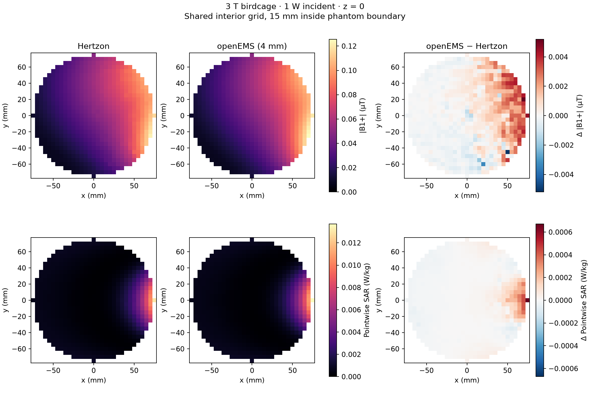
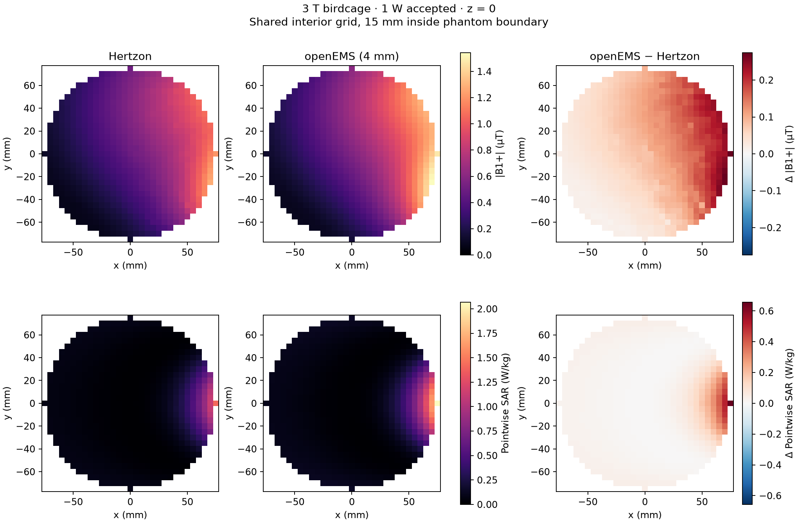

# Hertzon–openEMS comparison — 2026-11-11

The independent FDTD comparison is complete for the nominal 3 T birdcage in
`docs/results/config.json`. Higher-order Hertzon and 4 mm openEMS give almost
identical interior B1+ patterns (complex correlation **0.99974**). Whole-phantom
mean B1+ differs by **2.47% at equal incident power**, but **20.97% at equal net
accepted power**. The power-normalization disagreement remains unresolved.
These results support the comparison workflow; they do not establish a validated
coil or SAR prediction.

The [machine-readable evidence](results/openems/) includes both FEM references,
FDTD reports, manifests, sensitivity checks and figures. Full inputs, raw fields,
port traces and logs are in the
[comparison data prerelease](https://github.com/m9h/mri-rf-stack/releases/tag/openems-comparison-2026-11-11).
The original v0.1.0 benchmark is retained unchanged.

## Results

All calculations use 127.732435554 MHz, peak phasors, `exp(+iωt)`, B0 along +z,
and `Bplus = μ0(Hx+iHy)/2`. Whole-phantom means use each solver's native volumes.
The coil is unmatched, with eight nominal 30 pF capacitors and one 50 Ω feed.

| Quantity | Original Hertzon | Higher-order Hertzon | openEMS 6 mm | openEMS 4 mm |
|---|---:|---:|---:|---:|
| Accepted W per 1 W incident | 0.0146015 | 0.00923230 | 0.00714446 | 0.00662410 |
| Phantom mass, kg | 4.52048 | 4.55433 | 4.63968 | 4.59936 |
| Absorbed W per 1 W accepted | 0.75237 | 0.65247 | 0.95036 | 0.95544 |
| Mean B1+, µT per √W accepted | 0.48216 | 0.45238 | 0.54405 | 0.54723 |
| Mean SAR, W/kg at 1 W accepted | 0.16644 | 0.14326 | 0.20483 | 0.20773 |

The phantom's analytic mass is 4.58044 kg. Its curved surface is represented by
straight tetrahedra in FEM and cell-centre material sampling in FDTD.

The higher-order FEM run uses Hertzon's `First Order` basis (EMerge's
`SecondOrderMixedVolakis`), 20 mm initial tissue mesh and ΔS threshold 0.005.
It stopped at ten adaptive passes, 56,176 tetrahedra and ΔS = 0.004704.
The original used `Zero Order`, 35 mm initial tissue mesh and ΔS threshold 0.02,
stopping at seven passes and 16,189 tetrahedra. **Both are S-parameter stopping
criteria, not field-convergence certificates.**

The final FDTD references use a Gaussian pulse with a 10 MHz cutoff offset,
fourfold frequency-dump oversampling and requested energy decay of −80 dB.
The 6 mm run has 627,984 cells and stopped after 39,920 steps at −88.45 dB;
the 4 mm run has 2,080,768 cells and stopped after 73,920 steps at −89.12 dB.
Native logs call the mesh-node count “FDTD cells”; the counts here are actual
Cartesian cells. Both reference runs used the Metal backend on an Apple M5 Max.

## Why the power basis matters

For this single real-reference port, accepted power is `1 − |S11|²` times
incident power. The incident-power diagnostic rescales fields by the square root
of this fraction and absorption by the fraction; it does not fit amplitudes.

| At 1 W incident | Higher-order Hertzon | openEMS 4 mm | Relative difference |
|---|---:|---:|---:|
| Mean B1+ magnitude, µT | 0.0434664 | 0.0445380 | +2.47% |
| Phantom absorption, W | 0.00602384 | 0.00632896 | +5.07% |
| Accepted minus phantom absorption, W | 0.00320846 | 0.000295138 | −90.80% |

The last row is a power remainder, **not a measured radiation flux**. It can
include outward power and numerical power-balance error. Its disagreement makes
outer-boundary sensitivity and an explicit flux audit useful next checks; these
runs do not prove a boundary-related cause. At equal accepted power, openEMS
predicts 46.43% more phantom absorption than higher-order Hertzon.





On 21,979 common points spaced 5 mm apart and at least 15 mm inside the nominal
phantom boundary, B1+ magnitude NRMSE is 2.38% at equal incident power and 20.33%
at equal accepted power. Complex correlation is 0.99974 in either case. Allowing
one global phase rotation gives complex NRMSE 2.96% and 20.42%, respectively.
The fitted phase is about π, consistent with opposite native port terminal
orientation; absolute inter-solver phase agreement is not claimed. No spatial
registration or amplitude fitting is applied. Original low-order FEM has lower
complex correlation, 0.97493, against the same final 4 mm FDTD result.

The figures show pointwise SAR on the shared grid. Peak SAR is not compared:
native tetrahedron means and FDTD cell-interpolated values are different
estimators. No 1 g or 10 g averaging is performed.

## Sensitivity and implementation checks

- Refining FDTD from 6 to 4 mm changes accepted-power-normalized mean B1+ by
  +0.585% and phantom absorption by +0.536%. Accepted fraction changes by −7.28%;
  incident-power-normalized B1+ and absorption change by about −3.15% and −6.79%.
  Two grids do not establish convergence of all quantities.
- On the 6 mm grid, halving the Gaussian cutoff offset from 10 to 5 MHz at the
  same −80 dB target changes mean B1+ by −0.00805% and absorption by −0.0161%.
- A separate 6 mm, 5 MHz run requesting −100 dB showed late-time energy growth.
  It was stopped at 1,169,643 steps (−66.05 dB), rejected by the runner and
  excluded from field comparisons. Its status and log are retained. Reaching
  −80 dB in the finite reference windows does not establish long-time stability.
- The earlier 80 MHz, −60 dB coarse CPU/Metal comparison gives absolute S11
  difference 2.80×10⁻⁸, B1+ difference 2.68 ppm and absorption difference 5.42 ppm.
  This checks engine consistency on that case, not physical accuracy.
- Earlier wideband runs were more sensitive to truncation: using the first 75%
  of their port records changes accepted fraction by +7.66% at 6 mm and +0.773%
  at 4 mm. Those outputs remain diagnostics, not the final reference. Prefix
  windows can include active excitation and are not independent decay tests.
- Native PEC edge graphs contain the expected four components on both final
  grids: shield, lower ring/rungs, upper ring/rungs, and feed-to-capacitor strip.
  Every rung retains 12 mm projected width and 30 pF total capacitance.
- Numerical tests cover strip/capacitor discretization, analytic quadratic
  complex FEM interpolation, phase-only comparison without hidden amplitude
  fitting, and rejection of aborted or insufficiently decayed solver output.

See [sensitivity.json](results/openems/sensitivity.json) for exact differences
and hashes, and each run's manifest for geometry and numerical settings.

## Matching and discretization

The nominal radii, lengths, widths, gaps, capacitors, homogeneous phantom and
feed are shared. The air box is x/y = ±320 mm and z = ±330 mm, omitting only
Hertzon's 0.1 µm OpenCASCADE tolerance. Hertzon's first-order absorbing boundary
and openEMS's first-order Mur boundary are different implementations; the same
box does not establish equal reflection error.

openEMS uses zero-thickness Cartesian staircase sheets for the open shield and
strips, and rasterized planar annular rings. Mesh-dependent plane errors are
recorded in the manifest. This differs from FEM's geometric discretization.
Capacitors are distributed across unique axial edges with positive weights
summing to 30 pF per rung. Rotated RLC boxes are avoided because the native
circuit implementation snaps untransformed box coordinates.

Native material density, conductivity and cell volume come from the raw SAR
dump. Cell-interpolated E supplies local SAR; H is cell-interpolated in this
uniformly nonmagnetic model. Port and field DFT spectral units cancel in
`field/sqrt(P_acc)`. VI accepted power is checked against the 50 Ω wave powers.
FEM tet4/tet10 interpolants are evaluated without averaging across element
faces; complex FDTD fields are trilinearly interpolated.

## Reproduce

Install openEMS/CSXCAD C++ libraries and their Python bindings separately. The
full upstream meta-repository is pinned to
`622ac90e3f37700445df424779465e6a25d3c155`, openEMS to
`1d710c210920908a143b573f2babca05455f5479`, and CSXCAD to
`fdff4b551580952009c7243a29693e139d1da108`. Native banners identify development
versions after 0.37.0/0.7.0; Python fallback versions alone do not identify them.
Hertzon remains pinned by `requirements-solver.txt`.

See [upstream build instructions](https://docs.openems.de/en/latest/install/index.html)
and [the pinned Linux workflow](../.github/workflows/openems.yml). Do not install
an unrelated PyPI package named `openems`. Full Git clones preserve native tags.
The headless build needs CMake, a C++17 compiler, HDF5, TinyXML 1, Boost, zlib and
the bundled fparser. On macOS the build script fetches checksum-verified TinyXML.

With solver bindings installed, use new output directories:

```sh
PYTHONPATH=src python -m mri_rf.openems outputs/repro-6mm \
  --config docs/results/config.json --cell-mm 6 --bandwidth-mhz 10 --end-criteria 1e-8
PYTHONPATH=src python -m mri_rf.openems outputs/repro-4mm \
  --config docs/results/config.json --cell-mm 4 --bandwidth-mhz 10 --end-criteria 1e-8
PYTHONPATH=src python -m mri_rf.cli solve \
  docs/results/openems/hertzon-higher-order/birdcage.hzn outputs/repro-fem
PYTHONPATH=src python -m mri_rf.compare \
  --hertzon outputs/repro-fem \
  --config docs/results/openems/hertzon-higher-order/config.json \
  --openems outputs/repro-6mm outputs/repro-4mm --output outputs/repro-comparison
PYTHONPATH=src python examples/plot_comparison.py outputs/repro-comparison
PYTHONPATH=src python examples/plot_comparison.py outputs/repro-comparison --incident
```

`--engine gpu` selects a supported native GPU backend; CPU is the default.
`--postprocess` rechecks an existing run using its saved settings. Step-limited
or aborted runs are rejected. `examples/check_openems_topology.py RUN` audits
native PEC connectivity with PyVista. `examples/check_openems_time_window.py RUN`
checks port spectra from recorded time-window prefixes. The Linux CI solve uses
a separate −40 dB smoke criterion and is not the local reference calculation.

## Remaining work

Resolve the power remainder using boundary-distance/condition studies and an
explicit surface-flux calculation. Continue mesh/order and field-specific
convergence checks, investigate the late-time FDTD tail, then tune/match the
coil. Anatomical loads, realistic multichannel arrays, mass-averaged SAR,
thermal modelling and measurements remain separate development steps.

Primary implementation references:

- [openEMS ports and power processing](https://docs.openems.de/en/latest/python/openEMS/ports.html)
- [Field dump conventions](https://docs.openems.de/en/latest/python/CSXCAD/CSProperties/CSPropDumpBox.html)
- [Pinned circuit discretization](https://github.com/thliebig/openEMS/blob/1d710c210920908a143b573f2babca05455f5479/FDTD/operator.cpp)
